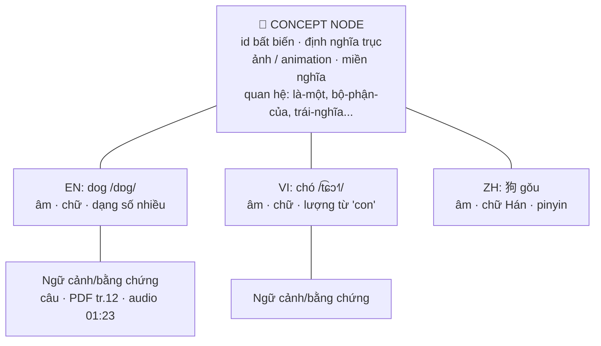

# PLAN-043 — Worklist đa ngữ theo "khái niệm trung tâm": tham vấn ngôn ngữ học + kế hoạch 5 mục

- **Nguồn:** người sở hữu (2026-11-02, qua agent `arena/d2aeb948-in4up`) — 5 mục
  Worklist: (1) hệ thống đa ngữ từ ý nghĩa → âm thanh → chữ viết; (2) Worklist
  đọc Gốc + Dịch; (3) thêm hàng loạt bằng prompt/AI; (4) hình ảnh linh hoạt hơn;
  (5) hoạt ảnh không phải dán link.
- **Trạng thái:** 📋 proposed — **bản THẢO LUẬN, chưa code** (owner yêu cầu
  "thảo luận trước" ở mục 1/2/3/5).
- **Card liên quan:** `CONCEPT-001` (mới), `WORDLIST-TTS-001` (đã có,
  Linear PSRC-33), `WORDLIST-AI-IMPORT-001` (mới), `IMG-WEB-002` (mới),
  `LOTTIE-LIB-001` (mới).
- **ADR cần có trước khi code mục 1:** ADR-0023 (đặt chỗ — chỉ viết khi owner
  chốt hướng, theo quy tắc vàng #4).

---

## 0. Hiện trạng thật trong repo (điểm xuất phát của mọi đề xuất dưới đây)

| Vùng | Sự thật đã kiểm trong code |
|---|---|
| Mô hình từ | `WordEntry` (`lib/models/word_entry.dart`): 1 `word` + 1 `meaning` (chuỗi tự do) + `language`/`languages[]` là **tag**, không phải các bản thể ngôn ngữ riêng. Hai entry "dog (EN)" và "chó (VI)" hiện là **hai đảo độc lập** — chưa có nút khái niệm chung. Đã có `parentIds`/`childIds` + màn `knowledge_graph_screen.dart` (chỉ quan hệ cha–con). |
| Lớp tri thức MVA | `lib/knowledge/models/knowledge_unit.dart`: `KnowledgeUnit` bất biến theo `unitId`, có `senseNote` phân biệt nghĩa ("bank" ngân hàng ≠ bờ sông) và luật cứng **trùng chữ KHÔNG tự merge — người dùng xác nhận** (AT2). Đây là tiền lệ rất tốt cho mục 1. |
| Phát Worklist | `wordlist_playback_service.dart`: **chỉ đọc `entry.word`**, có lặp theo từng từ + lặp cả danh sách + bubble; **chưa đọc nghĩa, chưa truyền `language:`** xuống `TtsService.speak(text, {language})` (engine đã hỗ trợ truyền ngôn ngữ). Đây chính là card mở `WORDLIST-TTS-001`. |
| Mẫu "đọc gốc + dịch" đã có | Tab Đọc: `lib/screens/read_mode/services/playback_engine.dart` (recipe `enRepeats`/`viRepeats`/khoảng lặng/lượt cả bài + đổi locale từng pha). YouTube: `yt_read_aloud_sequence.dart` — **sequence builder THUẦN đã có test** (mode sourceOnly/targetOnly/interleaved, số lần lặp từng phía, dòng thiếu dịch thì đọc gốc). Mục 2 nên **kế thừa khuôn này**, không phát minh lại. |
| Nhập hàng loạt | `word_import_sheet.dart` (1674 dòng): 3 tab (Dán/Clipboard, Từ văn bản, File .txt/.csv), parser header-alias rất chắc (`word, meaning, ipa, topic, example, example_simple, example_complex, language, image_url, image_url_2`), xem trước + tick chọn + badge "đã có" + **smart-fill chỉ điền chỗ trống**. **Chưa có** nút copy-prompt, chưa có AI trực tiếp, và parser **chưa bóc** code-fence/bảng Markdown (định dạng AI hay trả về). |
| Hạ tầng AI | Đã có tầng Server API OpenAI-compat (`AiEngineRemote` + `chatStream`), AI local GGUF (`AiEngine`), chuỗi dịch LLM (`LlmMtEngine`), từ điển MDX + thác IPA (MDX→CMU→G2P, ADR-0005). Mục 3 **cắm vào các tầng này**, không thêm đường API mới. |
| Hình ảnh | **Không phải chỉ Pexels**: `vocab_image_web_service.dart` có 4 nguồn (Pexels, Unsplash — cần key của user; Openverse, Wikimedia — không cần key) nhưng logic là *nguồn ưu tiên gọi trước, có kết quả là dừng*, trần **40 ảnh/lượt, không phân trang/"tải thêm"**. Sheet cao 86% màn hình, lưới 2–5 cột tỉ lệ 0.78 kèm dòng ghi nguồn → ô ảnh nhỏ ("eo hẹp"); **chạm ô là tải+dùng ngay**, không xem lớn trước. |
| Dung lượng ảnh | Ảnh tải về **lưu nguyên bytes** (Pexels lấy bản `large2x`, Unsplash lấy bản `full`, trần 8MB) — **chưa có bước resize/nén lại**. Gói `image` đã có sẵn trong `pubspec.yaml`. |
| Hoạt ảnh | `VOCAB-MEDIA-003` đã thêm tab "Hoạt ảnh" duyệt thư viện + xem trước, nhưng nguồn mặc định là Wikimedia Commons (`filemime:application/json`) — kho Lottie ở đó gần như trống cho từ vựng phổ thông; endpoint tùy chỉnh đòi user kỹ thuật. Nên trên thực tế người dùng **vẫn chủ yếu dán link / nhập file**. LottieFiles (kho lớn nhất) **không có public API tìm/tải animation miễn phí** (xác nhận chính thức trên diễn đàn của họ, 08-2026) — họ chỉ đường sang IconScout API (trả phí là chính). |

---

## 1. Mục 1 — "Ý nghĩa → Âm thanh → Chữ viết": tham vấn chuyên gia ngôn ngữ

### 1.1 Trực giác của bạn đúng ở trục chính — và cần 4 chỗ tinh chỉnh

Chuỗi **khái niệm → âm thanh → chữ viết** khớp với nền tảng ngôn ngữ học:

- **Saussure**: dấu hiệu ngôn ngữ = *cái được biểu đạt* (khái niệm trong đầu) +
  *cái biểu đạt* (hình ảnh âm thanh). Chữ viết, với đa số ngôn ngữ, là hệ thống
  **thứ cấp ghi lại lời nói** — xuất hiện sau tiếng nói hàng vạn năm, và trẻ em
  mọi nơi đều nói trước khi viết.
- **Tam giác ngữ nghĩa Ogden–Richards**: Từ (kí hiệu) không nối thẳng tới vật
  trong thế giới, mà nối **qua khái niệm trong đầu**. Vì vậy "học từ X" thực
  chất là xây 2 cạnh: *khái niệm ↔ âm/chữ của X*.

Bốn tinh chỉnh quan trọng cho thiết kế sản phẩm:

1. **Không phải lúc nào chữ cũng trỏ về âm.** Chữ Hán/chữ Nôm (và phần kanji)
   mang cả *nghĩa* trong nét chữ; số và ký hiệu (`5`, `+`, `♥`) đọc khác nhau
   ở mỗi ngôn ngữ nhưng hiểu như nhau; ngôn ngữ ký hiệu (thủ ngữ) đi thẳng
   *khái niệm → cử chỉ*, không qua âm. ⇒ Mô hình nên là **khái niệm ở giữa,
   mỗi ngôn ngữ gắn 3 biểu diễn song song: âm (kèm IPA), chữ, (và cử chỉ/video
   nếu sau này cần)** — thay vì chuỗi thẳng một chiều.
2. **Khái niệm không phải lúc nào cũng 1–1 xuyên ngôn ngữ.** Tiếng Anh
   `brother` ↔ tiếng Việt phải tách `anh trai`/`em trai`; có ngôn ngữ tách 2
   màu xanh lam thành 2 từ cơ bản; từ chỉ chuyển động đóng gói "cách đi" và
   "đường đi" khác nhau giữa các họ ngôn ngữ. ⇒ Nút khái niệm phải cho phép
   quan hệ **1–nhiều, nhiều–nhiều**, và "tách nghĩa" (sense split) — đúng như
   `senseNote` của `KnowledgeUnit` đã lường trước.
3. **Hình ảnh là ngôn ngữ chung — nhưng chỉ cho phần cụ thể.** Danh từ/động
   từ nhìn thấy được (con mèo, chạy, đỏ) thì ảnh/animation là cầu nối hoàn
   hảo. Từ trừu tượng/chức năng (*công lý, mặc dù, sự hối tiếc, đã/đang/sẽ*)
   không có "một bức ảnh" — chúng cần **định nghĩa đơn giản + cảnh ví dụ +
   cặp trái nghĩa + ngữ cảnh câu**. ⇒ Nút khái niệm cần nhiều loại "neo
   nghĩa": ảnh, animation, định nghĩa trục (pivot gloss), câu ví dụ mẫu —
   ảnh là neo ưu tiên, không phải neo duy nhất.
4. **IPA là cầu nối phổ quát giữa âm và chữ** — app đã đầu tư đúng chỗ này
   (thác IPA + tô màu phoneme). Trong mô hình đa ngữ, IPA đóng vai trò "âm
   viết ra được" để người học so sánh âm giữa các ngôn ngữ mà không bị chữ
   viết bản ngữ đánh lừa.

### 1.2 Vì sao mô hình này tốt cho người học (bằng chứng sư phạm)

- **Lý thuyết mã kép (Paivio) + hiệu ứng ưu thế hình ảnh**: thông tin được
  mã bằng cả kênh lời và kênh hình thì nhớ bền hơn hẳn chỉ-kênh-lời
  (từ↔bản dịch). Nút khái niệm có ảnh = biến mỗi từ thành mã kép.
- **Mô hình phân cấp sửa đổi (Kroll & Stewart)**: người mới học đi đường
  vòng *từ L2 → từ L1 → khái niệm*; người giỏi đi thẳng *từ L2 → khái niệm*.
  Học qua cặp dịch thuần tuý **củng cố đường vòng**. Thiết kế lấy khái niệm
  làm trung tâm (nhìn ảnh/nghe âm → bật ra từ) là cách tập cho não đi đường
  thẳng — đây là khác biệt sư phạm cốt lõi so với app dịch từng cặp.
- **Thứ tự tiếp thu tự nhiên**: nghe âm → gắn nghĩa → bắt chước nói → chữ
  viết đến sau. Sản phẩm có thể cho chế độ "ẩn chữ cho tới khi quen âm" như
  một lựa chọn — đặc biệt hữu ích với ngôn ngữ mà chữ viết gây nhiễu phát âm
  (tiếng Anh) hoặc chữ tượng hình (học âm + pinyin trước, chữ Hán sau).
- **Cảnh báo nhiễu đa ngữ**: học đồng thời nhiều bản dịch của cùng một khái
  niệm khi chưa vững ngôn ngữ đầu tiên dễ gây lẫn (nhất là ngôn ngữ gần
  nhau). ⇒ Hệ thống nên **neo vững một ngôn ngữ trước** (ví dụ đã qua vài
  chu kỳ SM-2), rồi mới *gợi ý* "gắn thêm ngôn ngữ mới vào khái niệm này".

### 1.3 Thiết kế đề xuất: "Nút Khái niệm" (Concept Neuron)



Nguyên tắc bất biến (khớp luật dự án):

- **Additive tuyệt đối**: thêm kho `ConceptNode` mới + trường tuỳ chọn
  `conceptId` trên `WordEntry`. Entry không có `conceptId` hoạt động y như
  hôm nay. Không migration phá huỷ (tiền lệ ADR-0013 `imageUrl2`).
- **SM-2 nằm ở bản thể ngôn ngữ, KHÔNG nằm ở khái niệm**: biết "dog" (EN)
  không có nghĩa biết "狗" (ZH). 3 kỹ năng Hiểu–Nghe–Đọc vẫn tách biệt
  (quy tắc vàng #2). Nút khái niệm chỉ *tổng hợp độ phủ*: "khái niệm này bạn
  đã có ở 3/5 ngôn ngữ".
- **Không tự gộp**: máy chỉ *đề xuất* nối (trùng nghĩa chuẩn hoá, trùng ảnh,
  là cặp dịch của nhau…) — người dùng bấm xác nhận (đúng luật AT2/MVA).
- **Ảnh/animation gắn ở khái niệm** (dùng lại cho mọi ngôn ngữ) — nối thẳng
  tới mục 4/5: tìm ảnh **một lần**, mọi ngôn ngữ hưởng chung. Entry vẫn có
  thể có ảnh riêng ghi đè nếu cần.

### 1.4 Lộ trình theo pha (mỗi pha dùng được ngay, không "đại tu")

| Pha | Nội dung | Kết quả nhìn thấy |
|---|---|---|
| **A — Nối** | Kho `ConceptNode` (additive) + `conceptId`; công cụ "gợi ý nối" các entry sẵn có (theo cặp dịch/nghĩa trùng/ảnh trùng) để user duyệt nối; màn chi tiết khái niệm: ảnh ở giữa, các ngôn ngữ xung quanh kèm IPA + nút nghe. | Từ danh sách phẳng thành chòm khái niệm; học thêm ngôn ngữ = gắn thêm một cánh vào chòm đã biết. |
| **B — Thêm ngôn ngữ** | Từ màn khái niệm: "+ Thêm ngôn ngữ" → tra bằng chuỗi sẵn có (từ điển → dịch máy/LLM → IPA waterfall → TTS thử) → xem trước → lưu thành entry mới đã nối sẵn. | Học đa ngữ *theo khái niệm*, không phải nhập lại từ đầu. |
| **C — Ôn theo khái niệm** | Dạng ôn mới: xem ảnh → nhớ từ ở ngôn ngữ đích; nghe âm ngôn ngữ A → nói/viết ở ngôn ngữ B; ẩn chữ/hiện chữ theo tầng. Gợi ý "đã vững EN — gắn thêm ZH?" khi đạt ngưỡng. | Luyện đường thẳng khái niệm ↔ dạng thức (mục 1.2). |
| **D — Nối tri thức ngoài (tuỳ chọn)** | Gắn mã ngoài làm *gợi ý + chứng minh nguồn*: Wikidata QID (miễn phí, mỗi khái niệm có nhãn đa ngữ + ảnh Commons), ConceptNet (API miễn phí, quan hệ thường thức đa ngữ). Tải lười, cache offline, **không phụ thuộc cứng**. | Tự động gợi ý bản dịch/ảnh/quan hệ cho khái niệm mới. |
| **E — Mạng nơ-ron nghĩa** | Thêm quan hệ ngoài cha–con: *là-một-loại, bộ phận, trái nghĩa, hay-đi-cùng (collocation)*; màn Knowledge Graph hiện tại vẽ thêm các cạnh này; gợi ý học lan truyền ("bạn đã biết *nước* — học tiếp *mưa, sông, khát*?"). | Đúng hình ảnh "connect như nơ-ron": kích hoạt lan toả theo mạng nghĩa. |

### 1.5 Quyết định cần owner chốt (mục 1)

- **Q1. Độ sâu đầu tư**: chỉ Pha A (nối + xem) để kiểm chứng cảm giác dùng,
  hay cam kết A→C ngay từ đầu? (Khuyến nghị: A trước, nghiệm thu trên máy
  thật rồi mới B/C.)
- **Q2. Nguồn gắn ngôn ngữ mới ở Pha B**: dịch máy chuỗi hiện có là đủ,
  hay bắt buộc qua AI để có cả ví dụ/giải thích? (Khuyến nghị: từ điển/dịch
  trước, AI chỉ bổ sung chỗ thiếu — rẻ và ít bịa.)

---

## 2. Mục 2 — Worklist đọc Gốc + Dịch (tuỳ chỉnh số lần + ngôn ngữ)

> Mở rộng card sẵn có **WORDLIST-TTS-001** (Linear PSRC-33) — không mở card
> trùng. Khác biệt so với bản ghi cũ: thêm **số lần lặp từng phía**, **khoảng
> lặng gợi nhớ** và **chọn (các) ngôn ngữ đọc**.

### 2.1 Thiết kế

- **Bộ dựng chuỗi THUẦN** `WordlistReadSequence` (khuôn
  `yt_read_aloud_sequence.dart`): vào = danh sách entry + cài đặt, ra = danh
  sách bước `{entryId, phía: từ/nghĩa, ngôn ngữ, nội dung}` — test thuần
  không cần TTS thật. `WordlistPlaybackService` chỉ việc phát theo chuỗi và
  truyền `language:` từng bước xuống `TtsService`.
- **Cài đặt (persist, khuôn `YtLearningSettings`)**:

  | Tuỳ chọn | Giá trị | Mặc định đề xuất |
  |---|---|---|
  | Chế độ | Chỉ từ · Chỉ nghĩa · Từ→Nghĩa · Nghĩa→Từ · **Gợi nhớ** (nghĩa → lặng để tự nhớ → từ) | Từ→Nghĩa |
  | Số lần đọc TỪ | 0–5 | 2 |
  | Số lần đọc NGHĨA | 0–5 | 1 |
  | Khoảng lặng giữa hai phía | 0–5 giây (ở chế độ Gợi nhớ là thời gian tự nhớ) | 0.7s |
  | Khoảng lặng giữa các từ | 0–3 giây | 0.5s (như hiện tại) |
  | Lặp cả danh sách / lặp từng từ | giữ nguyên cơ chế đã có | như hiện tại |
  | Ngôn ngữ đọc TỪ | theo `entry.language` từng từ (tự động) | — |
  | Ngôn ngữ đọc NGHĨA | chọn 1 ngôn ngữ "nghĩa của tôi viết bằng…" | ngôn ngữ mẹ đẻ trong cài đặt app |
  | Đảo ngẫu nhiên thứ tự | bật/tắt | tắt |

- **Điểm sư phạm đáng giá nhất là chế độ Gợi nhớ**: nghe nghĩa → *im lặng để
  não tự bật ra từ* → nghe đáp án. Đọc xuôi cả hai phía là nghe thụ động;
  chèn khoảng lặng biến nó thành ôn tập chủ động (active recall) mà không
  cần chạm màn hình — rất hợp nghe khi đi đường/làm việc khác.
- **Cầu nối sang mục 1**: khi entry thuộc một khái niệm có nhiều ngôn ngữ,
  chuỗi đọc mở rộng tự nhiên thành nhiều phía: *EN ×2 → VI ×1 → ZH ×1* —
  "nguồn ngữ muốn lặp" mà bạn nhắc chính là chọn các cánh của khái niệm.
  Thiết kế bước đọc theo `{ngôn ngữ, số lần}` ngay từ đầu để không phải
  sửa lại khi CONCEPT-001 Pha A xong.
- **Bubble + danh sách phải hiện phía đang đọc** (từ/nghĩa, ngôn ngữ, lần
  mấy) — tái dùng snapshot như tab Đọc.

### 2.2 Bẫy cần xử lý (thảo luận)

- `meaning` là chuỗi tự do do người dùng viết, có thể chứa ký hiệu không nên
  đọc to ("n. con chó; (mỉa mai)…"). Đề xuất: đọc nguyên văn ở bản đầu;
  nếu khó chịu mới thêm bộ lọc nhẹ (bỏ phần trong ngoặc/ký hiệu loại từ) —
  **không tự ý sửa dữ liệu người dùng**.
- Đổi ngôn ngữ liên tục làm một số engine TTS phải nạp lại giọng → có thể
  khựng nhịp. Cần nghiệm thu trên máy với engine mặc định của dự án
  (Edge/Piper/giọng máy) và báo trước trong sheet cài đặt nếu thiếu giọng
  cho ngôn ngữ đã chọn.
- Phát nghe **không tự chấm điểm SM-2** (giữ 3 kỹ năng tách biệt); tối đa
  ghi nhận "đã nghe" phục vụ thống kê, không đổi lịch ôn.

### 2.3 Nghiệm thu

1. Chuỗi thuần: đủ test cho 5 chế độ × lặp × entry thiếu nghĩa (bỏ bước
   nghĩa, không im lặng khó hiểu).
2. Trên máy: nghe đúng thứ tự/số lần; đổi cài đặt được ghi nhớ; bubble hiện
   đúng phía đang đọc; dừng giữa chừng sạch (cơ chế stop hiện tại).

---

## 3. Mục 3 — Thêm hàng loạt bằng Prompt / AI

### 3.1 Phương án tốt nhất: ba tầng, làm từ rẻ đến đắt

**Tầng 0 — Copy Prompt cho AI bên ngoài (làm trước, giá trị ngay, chi phí 0).**
Nút trong sheet Nhập hàng loạt: "Tạo prompt cho AI" với 3 kịch bản:
(a) *sinh từ vựng theo chủ đề + trình độ*; (b) *làm giàu danh sách từ tôi
dán vào*; (c) *trích từ vựng từ đoạn văn*. Prompt sinh ra đã nhúng sẵn:

- cặp ngôn ngữ (từ = ngôn ngữ đích đang học, nghĩa = ngôn ngữ của người học);
- đúng **header CSV mà parser hiện tại hiểu**:
  `word, meaning, ipa, topic, example, example_simple, example_complex, language`;
- luật định dạng: chỉ trả CSV thuần, bọc nháy khi có dấu phẩy, từ ở dạng
  nguyên thể (lemma), IPA chuẩn, nghĩa ngắn kiểu từ điển học viên (không
  dịch vòng), 1 ví dụ đơn giản mức A2;
- số lượng + chủ đề người dùng chọn ngay trong sheet.

Người dùng mang prompt sang bất kỳ AI nào (ChatGPT/Claude/Gemini…), dán kết
quả trở lại tab Dán — **đi qua đúng màn xem trước/tick chọn/smart-fill sẵn
có**. Việc kỹ thuật kèm theo, nhỏ mà bắt buộc: cho parser **bóc code-fence
và nhận bảng Markdown** (bỏ dòng ```` ```csv ````, bỏ hàng `|---|---|`) —
AI gần như luôn trả một trong hai dạng này.

**Tầng 1 — AI ngay trong app (làm sau, khi Tầng 0 đã chứng minh nhu cầu).**
Cắm vào hạ tầng có sẵn: Server API OpenAI-compat (`AiEngineRemote`) hoặc
model local khi sẵn sàng. Luồng: nhập chủ đề/danh sách từ → AI trả JSON
theo schema chặt → **vẫn đổ vào màn xem trước dùng chung** (không bao giờ
chen thẳng vào kho). Chia lô ~20 từ/request, có tiến trình + huỷ, báo rõ
"đang dùng AI nào, tốn phí phía nhà cung cấp của bạn". Chọn JSON thay vì
CSV cho đường máy-với-máy để parse bền (bài học parser chat đã có trong
KANBAN I4U18-HOME-AI-001).

**Tầng 2 — Làm giàu không-AI trước (rẻ, xác định, chạy offline).**
Trước khi gọi AI cho bất kỳ trường nào, chạy thác sẵn có: từ điển MDX →
IPA (CMU/G2P) → chuỗi dịch → glossary. AI chỉ điền phần còn thiếu (ví dụ,
giải nghĩa theo nghĩa cụ thể). Vừa giảm chi phí/độ bịa, vừa tôn trọng triết
lý offline-first.

### 3.2 Rào chắn chất lượng

- Mọi đường (dán/AI/file) đều qua xem trước + badge "đã có" + smart-fill
  không ghi đè — giữ nguyên hành vi hiện tại.
- Gắn nhãn nguồn gốc cho lô nhập (tag/chủ đề của lô) để sau này lọc/xoá cả
  lô AI sinh nếu chất lượng kém; tiền lệ `phoneticSource` cho thấy dự án đã
  có văn hoá ghi chứng minh nguồn.
- Prompt mẫu do app sinh phải **hiện để người dùng sửa trước khi copy** —
  minh bạch và dạy người dùng cách ra lệnh cho AI.

### 3.3 Quyết định cần owner chốt (mục 3)

- **Q3.** Tầng 0 trước (copy-prompt) rồi mới Tầng 1 (AI trong app) — đồng ý
  thứ tự này, hay muốn AI trong app ngay? (Khuyến nghị: Tầng 0 trước — một
  PR nhỏ, dùng được với mọi AI người dùng đang có, không phụ thuộc cấu hình
  API key trong app.)

---

## 4. Mục 4 — "Hình ảnh ghi nhớ": hết eo hẹp, nhiều kết quả, nhiều nguồn, ảnh nhẹ

### 4.1 Ba vấn đề tách bạch (đừng gộp một "fix")

1. **Không gian hiển thị eo hẹp** — bottom sheet 86%, lưới bị header + hàng
   trạng thái + hàng chọn nguồn chiếm chỗ; mỗi ô còn mất phần dưới cho dòng
   ghi nguồn.
2. **Ít kết quả** — một lượt tìm tối đa 40 ảnh từ **một** nguồn (nguồn ưu
   tiên có kết quả là dừng), không có "tải thêm".
3. **Ảnh nặng** — tải bản lớn rồi lưu nguyên (tới 8MB/ảnh) dù flashcard
   hiển thị nhỏ.

### 4.2 Giải pháp đề xuất

**Giao diện**
- Nâng sheet thành **trang gần-full-screen có thể kéo** (draggable tới
  100%), header thu gọn khi cuộn; lưới cho chọn mật độ (2/3/4 cột); ghi
  nguồn chuyển thành huy hiệu nhỏ đè góc ảnh thay vì chiếm một hàng chữ.
- **Chạm = xem lớn trước** (ảnh lớn + kích thước/dung lượng ước tính +
  nguồn/giấy phép + nút "Dùng ảnh này") — hiện tại chạm là tải dùng ngay
  nên người dùng không kịp đánh giá độ rõ/đúng nghĩa.

**Nhiều kết quả hơn**
- Nút **"Tải thêm" / cuộn vô hạn** bằng phân trang thật của từng nguồn
  (Pexels/Unsplash/Pixabay: tham số trang; Openverse: trang; Wikimedia:
  continuation) + khử trùng theo URL.
- Chế độ **tìm mọi nguồn song song, trộn kết quả** kèm chip lọc theo nguồn
  (thay vì nguồn đầu tiên có kết quả thì dừng) — giữ chế độ cũ làm tuỳ chọn
  "một nguồn ưu tiên" cho máy yếu/mạng chậm.
- **Gợi ý truy vấn**: chip đổi nhanh truy vấn — chỉ-từ / chỉ-nghĩa / bản
  tiếng Anh của nghĩa / từ đồng nghĩa — vì kho ảnh quốc tế gắn thẻ tiếng
  Anh là chính; kèm lọc loại ảnh: Ảnh chụp / Minh hoạ vẽ (với từ vựng, ảnh
  minh hoạ nền sạch thường *rõ nghĩa hơn* ảnh chụp đời thường).

**Thêm nguồn: Pixabay** (đề xuất nguồn thứ 5)
- Kho 4M+ gồm **ảnh chụp + minh hoạ + vector**, lọc được theo loại — đúng
  mảnh ghép "ảnh minh hoạ rõ nghĩa" mà 4 nguồn hiện tại yếu. API miễn phí
  bằng key của người dùng (đúng triết lý hiện tại: key lưu trên máy, không
  hard-code), cho phép dùng thương mại theo giấy phép Pixabay. Điều kiện
  cần tôn trọng khi tích hợp: **cache kết quả, hiển thị nguồn Pixabay ở
  lưới kết quả, tải về máy thay vì hot-link lâu dài** — cả ba đều khớp sẵn
  kiến trúc offline-first của app.
- Chưa đề xuất thêm nguồn khác ở đợt này (kho bảo tàng/khoa học quá hẹp
  cho từ vựng phổ thông); kiến trúc provider hiện tại thêm nguồn mới rẻ
  nên để ngỏ.

**Nhẹ mà vẫn rõ (đường ống dung lượng)**
- Tải **bản vừa đủ dùng** ngay từ nguồn (Pexels `medium`, Unsplash
  `regular` có tham số bề rộng, Pixabay bản web 640px, thumbnail Commons
  480px…) thay vì bản `full`/`large2x`.
- Khi lưu: **chuẩn hoá bằng gói `image` đã có** — thu cạnh dài nhất về
  ~1024px, mã hoá JPEG chất lượng ~80 cho ảnh chụp (giữ PNG chỉ khi có
  trong suốt), chạy trong isolate để không khựng UI. Mục tiêu nghiệm thu:
  **80–250KB/ảnh** mà hiển thị trên thẻ không phân biệt được bằng mắt.
- Hiện dung lượng ước tính ngay ở màn xem lớn trước khi lưu.

### 4.3 Nghiệm thu

Tìm một từ phổ thông → cuộn tải thêm ≥3 trang không trùng; bật trộn nguồn
thấy ≥2 nguồn trong một lưới; lưu 10 ảnh → tổng dung lượng thư mục
`vocabulary_images` nằm trong mục tiêu trên; ảnh cũ đã lưu không bị đụng.

---

## 5. Mục 5 — Hoạt ảnh: thoát khỏi cảnh phải dán link

### 5.1 Rào chắn thực tế

Kho Lottie lớn nhất (LottieFiles) **không cung cấp API công khai** để tìm/
tải animation miễn phí (xác nhận chính thức 08-2026); đường API họ chỉ là
IconScout (thiên về trả phí, phần miễn phí mỏng). Cào web (scraping) là
mong manh và rủi ro điều khoản — **không đề xuất**. Tab "Hoạt ảnh" hiện tại
dùng Wikimedia Commons nên kết quả gần như trống, khiến cảm giác "chỉ dán
link mới dùng được" là có thật dù UI đã có tab duyệt.

### 5.2 Bảng phương án

| Phương án | Ưu | Nhược | Kết luận |
|---|---|---|---|
| **A. Mở trình duyệt có hướng dẫn** — nút "Tìm trên LottieFiles" mở sẵn trang tìm kiếm theo từ khoá của từ; người dùng tải `.json/.lottie` rồi nhập file (luồng nhập file animation đã có từ LOTTIE-IMPORT-002) | Hợp lệ 100%, kho lớn nhất, làm ngay | Vẫn 2 bước thủ công | **Làm ở Pha 1** — kèm hướng dẫn 3 bước trong sheet |
| **B. Gói animation tuyển chọn theo khái niệm** — chỉ mục JSON (đặt trong repo/release) liệt kê vài trăm animation giấy phép mở đã kiểm duyệt, ánh xạ theo khái niệm/từ khoá; app tải chỉ mục 1 lần, tìm offline, xem trước, tải-khi-dùng | Mượt nhất, offline, kiểm soát dung lượng/chất lượng; gắn thẳng vào Nút Khái niệm (mục 1) dùng chung mọi ngôn ngữ | Tốn công tuyển + rà giấy phép từng file | **Làm ở Pha 2** — bắt đầu ~100 khái niệm cốt lõi (động vật, hành động, thời tiết, cảm xúc…) |
| **C. Nguồn API bằng key người dùng (IconScout)** theo khuôn Pexels hiện tại | Tìm trực tiếp trong app | Phụ thuộc gói trả phí của user; chất lượng phần free thấp | Tuỳ chọn Pha 3 nếu có nhu cầu thật |
| **D. GIF/video ngắn** (Pixabay video, WebM Commons) | Hành động đời thực rõ ràng | Nặng hơn Lottie nhiều, hiệu năng/pin trên thẻ kém | Không làm hướng chính; cân nhắc riêng nếu cần |
| **E. WebView nhúng LottieFiles + chặn tải** | Trải nghiệm "trong app" | Mong manh, điều khoản xám, tường đăng nhập | **Không làm** |

Giữ nguyên các kỷ luật hiệu năng đã có: trần 2MB/animation, chỉ ô đang hiện
mới chạy, trong danh sách thì đứng hình (`animate: false`).

### 5.3 Quyết định cần owner chốt (mục 5)

- **Q4.** Chấp nhận lộ trình A (ngay) → B (gói tuyển chọn) chứ? Nếu muốn B,
  ai là người duyệt danh sách 100 khái niệm đầu tiên (agent soạn nháp để
  owner duyệt, hay owner đưa danh sách)?

---

## 6. Thứ tự thi công đề xuất (sau khi owner chốt)

| Đợt | Việc | Cỡ | Phụ thuộc |
|---|---|---|---|
| 1 | **Mục 3 Tầng 0**: nút tạo/copy prompt + parser bóc fence/bảng Markdown + test | Nhỏ | không |
| 2 | **Mục 2**: `WordlistReadSequence` thuần + cài đặt + truyền `language:` + bubble hiện phía (mở rộng WORDLIST-TTS-001) | Vừa | không |
| 3 | **Mục 4 phần dung lượng**: tải bản vừa + chuẩn hoá khi lưu + hiện KB ở xem lớn | Nhỏ–vừa | không |
| 4 | **Mục 4 phần giao diện/kết quả**: trang full + xem lớn + tải thêm/phân trang + trộn nguồn + Pixabay | Vừa–lớn | đợt 3 |
| 5 | **Mục 5 Pha 1 (A)** + định dạng chỉ mục gói tuyển chọn (B) | Nhỏ (A) | không |
| 6 | **ADR-0023 + Mục 1 Pha A** (ConceptNode additive, gợi ý nối, màn khái niệm) | Lớn | owner duyệt ADR |
| 7 | Mục 1 Pha B/C · Mục 3 Tầng 1 (AI trong app) · Mục 5 gói B mở rộng | Lớn | đợt 6 |

Mọi đợt: tuân thủ hạt nhân dự án — chuỗi UI mới đủ `en/hi/zh/zh_TW/si`
(skill i18n), test thuần nối `app_analyze.yml`, dữ liệu thay đổi theo lối
additive, commit nhỏ + push ngay.

## 7. Quyết định của owner (2026-11-02)

| Câu hỏi | Chốt |
|---|---|
| Q1 — độ sâu Nút Khái niệm | **Chỉ Pha A trước** (nối + xem), nghiệm thu rồi mới tính Pha B/C. |
| Q2 — mặc định đọc Worklist | **Từ ×2 → Nghĩa ×1**. |
| Q3 — thứ tự nhập hàng loạt AI | **Cả hai trong một đợt**: copy-prompt cho AI ngoài + AI ngay trong app. |
| Q4 — đợt code đầu tiên | **Gói thắng nhanh**: mục 3 (cả hai tầng theo Q3) + mục 2 + mục 4 phần dung lượng ảnh. |

Ghi chú thi công (lệch có chủ đích so với mục 3.1, ghi lại để không mất dấu):
đường AI trong app ở bản đầu dùng **cùng định dạng CSV + cùng màn xem trước**
như đường copy-prompt (thay vì JSON riêng) — vì parser CSV hiện tại đã rất
chắc (căn cột bằng mỏ neo, chịu hàng lệch) và một đường xem trước duy nhất
giữ bảo đảm "người duyệt trước khi nhập" cho cả hai. Nguồn AI = tầng Server
API sẵn có (`AiProviderStore` năng lực `chat` + `OpenAiCompatClient`, đúng
khuôn `LlmMtEngine`); chưa cấu hình provider thì báo rõ và chỉ đường vào
màn Server & API — app hành xử như chưa có tính năng, không gọi mù.

## 8. Lịch sử

- 2026-11-02 | created→proposed | agent `arena/d2aeb948-in4up` | rà soát
  code thật 5 vùng (WordEntry/KnowledgeUnit, playback service, import
  sheet, image service+sheet, animation library) + kiểm chứng ngoài
  (LottieFiles không có public API; Pixabay API miễn phí kèm điều kiện
  cache/ghi nguồn) → viết bản thảo luận này; chưa sửa dòng code nào.
- 2026-11-02 | proposed→doing | agent `arena/d2aeb948-in4up` | owner chốt
  Q1–Q4 (mục 7) → thi công gói thắng nhanh: mục 2, mục 3 hai tầng, mục 4
  phần dung lượng.
- 2026-11-03 | doing→doing | agent `arena/d2aeb948-in4up` | owner duyệt
  bản trực quan `PLAN-043-visual.html` → đợt 2: ADR-0023 + **Pha A mục 1**
  (ConceptNode/conceptId/gợi ý nối/UI, test thuần + CI); mục 4 hoàn tất
  phần còn lại (Pixabay, phân trang, gộp nguồn, sheet 92% + xem trước
  lớn + tải thêm + mật độ + chip truy vấn); mục 5 Pha 1 (hướng dẫn
  LottieFiles + nhập file) + soạn danh mục 100 khái niệm cốt lõi
  (`PLAN-043-animation-core-concepts.md`) chờ duyệt cho Pha 2. Toàn cây
  CI 🟢 run `41594791234`; còn lại là nghiệm thu trên máy thật.
- 2026-11-05 | doing→doing (LOTTIE-LIB-001 Pha 2 xong code) | agent
  `arena/d2aeb948-in4up` | owner duyệt danh sách 100 concept → sinh 100
  pictogram Lottie hình học gốc In4Up CC0 (tổng ~289KB) + catalog offline;
  tìm theo EN/VI bỏ dấu, gắn vào tab Animation trong picker, xem trước rồi
  lưu qua chung media funnel (hỗ trợ `ConceptNode.imageRef`). Thêm parser
  test vào PLAN-043 CI. Analyze + PLAN-043 tests 🟢 run `41964276729`;
  còn nghiệm thu máy thật. Pha 3 không thuộc phạm vi đã duyệt.
- 2026-11-06 | doing→doing (định danh sau rebase) | agent `arena/d2aeb948-in4up` | tip 251e đã dùng PLAN-041 cho READ-UI-120 và ADR-0021 cho Tab Đọc; đổi worklist này sang PLAN-043 + ADR-0023 để tránh trùng ID, không đổi scope hay nội dung đã duyệt. Analyze + PLAN-043 tests `42092342813` 🟢.
